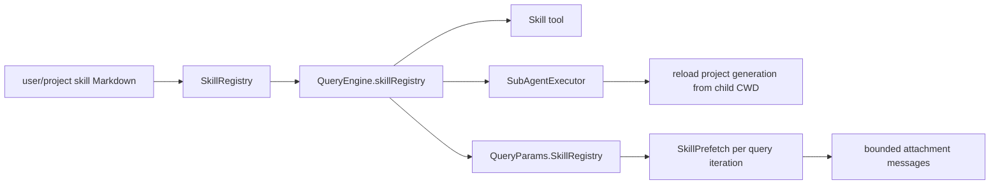

# Skills

**Status:** current
**Last verified:** 2026-10-24

> **Ownership:** This file owns skill parsing, registry precedence, engine
> binding, invocation, and query-time prefetch. Plugin discovery and whether
> plugin skills reach bootstrap belong in [`plugins.md`](plugins.md).

## Current Boundary

Skills are engine-bound runtime data. `NewQueryEngine` accepts an injected
`SkillRegistry` or loads defaults for its CWD, registers a Skill tool bound to
that registry, and injects it into tool execution contexts. A
worktree-isolated child clones non-project entries and reloads only the
project-sourced generation from the worktree before model entry. Its
model-visible Skill description and invocation context use that same isolated
generation, so dirty parent skill content omitted from committed HEAD cannot
leak into the child.

Default precedence, from low to high, is `~/.claude/skills`,
`~/.agents/skills`, `<project>/.claude/skills`, then `<project>/.agents/skills`.
Session resume reloads the registry for the restored CWD and rebinds command
discovery to it. A directory containing `SKILL.md` is one bundle: its support
Markdown files do not become separate skills. A missing bundle name defaults
to the directory name; flat Markdown files remain supported.

File-backed Skill tool results, prefetch attachments, and explicit skill
commands include the loaded source file and its containing base directory.
Relative support paths resolve from that directory, even when the conversation
CWD is elsewhere. This is prompt context: it does not read support files,
execute scripts, change CWD, or grant tool permissions. Programmatically
registered skills without a file path keep their existing plain tool/prefetch
body; `Skill.Render` and `SkillRegistry.Invoke` also remain body-only APIs.

## Symbol Flow



| Operation | Behavior |
|---|---|
| parse | YAML frontmatter plus Markdown body; filename or bundle directory supplies a missing name |
| load | recursive flat Markdown and `SKILL.md` bundles; records retain source and malformed files become diagnostics |
| invoke | validates required/default arguments and substitutes `{{name}}` placeholders |
| direct tool use | execution resolves the per-engine registry from context before the package-level compatibility registry |
| worktree child | preserves user/runtime sources, replaces project-source skills from the worktree's `.claude/skills` and `.agents/skills`, and fails launch if that reload fails |
| prefetch | each query iteration matches the latest user message against skill name, tags, and description words; bounded matches become user-role meta attachments |

Prefetch accepts one valid `Start` per instance before launching its background
worker. `Collect` waits for that accepted worker to publish its result, even
when discovery has not been scheduled yet; concurrent collectors share the
same completed result. Collecting before a valid start returns empty without
disabling a later start. Collection uses the existing runtime safe point and
does not add a model round or invoke supporting files.

At the after-tool safe point, `SkillPrefetch.CollectMissing` compares candidates
with the current model-visible context. An existing user-role meta attachment
with kind `skill_prefetch`, the same skill name, and identical rendered content
suppresses another delivery. Ordinary user text and other attachment kinds do
not suppress guidance. Filtering leaves the existing history and completed
discovery result unchanged.

This check uses the active context after compaction, rather than a sticky
session-level delivery flag. Guidance removed from that context can be delivered
again; a changed rendered source header or body also remains eligible. Existing
historical duplicates are retained rather than rewritten.

Prefetch renders one detached skill generation so its source locator and body
cannot come from different registry updates. The existing 4,000-byte budget
includes the complete source header and body, followed by a truncation marker
when needed. Only the body is shortened, at a UTF-8 boundary. If a source header
alone cannot fit, automatic prefetch skips it; explicit invocation remains
available.

Before the provider request is snapshotted, `ProjectSkillToolResults` projects a
shorter reference for a successful plain-text Skill result only when its exact
complete rendered content is already present in an earlier skill-prefetch
attachment. The paired Skill call must name the same skill; source headers stay
in the reference. Truncated prefetch, different arguments or generations,
errors, and non-text results retain their existing content. Tiny results are
unchanged when a reference would not save bytes.

This projection leaves canonical tool results, hooks, events, and session history
unchanged. After compaction removes the earlier attachment, the retained full
tool result is eligible for the next model request again. There is no persistent
"already loaded" flag. Only preceding attachments can justify a reference, so
later prefetch or registry updates cannot rewrite an already sent prefix. The
projection adds no model calls and preserves ordinary permissions and budgets.

The package-level `tools.DefaultSkillRegistry` remains a compatibility fallback.
Production `QueryEngine` tool execution injects its own registry, so independent
engines do not need to share that global owner.

`/skills` reads a detached registry snapshot through
`QueryEngine.RuntimeInspectionSnapshot`. It reports source and health for live
skills and the count of rejected source files; it does not re-walk directories
or treat skipped malformed files as a healthy empty registry.

## Explicit skill commands

[`Registry.SetSkillRegistry`](../../../engine/commands/skill_commands.go) projects
one in-memory skill snapshot into the shared TUI/Plain command registry. Each
user-invocable skill has a canonical `/skill:<name>` command and an unqualified
`/<name>` alias when no core, plugin, removed command, or qualified skill already
owns that name. `skill:` is reserved for this projection; static and plugin
registrations in that namespace fail validation. Static commands retain
precedence for short aliases. Discovery and dispatch use
the same projection; handlers capture the skill bytes shown by that snapshot.
Skill discovery during command-name completion reads this in-memory snapshot;
it never re-walks skill directories.

`argument-hint` supplies display text; declared `args` supply a fallback hint,
positional binding, required checks, and defaults. Quoted arguments remain one
value. `{{name}}` uses the existing named substitution; `$ARGUMENTS` expands the
joined command arguments without shell evaluation. Free-form or extra arguments
are appended when the body has no `$ARGUMENTS` placeholder. The resulting prompt
includes the skill source path and base directory so relative support files
can be resolved and uses the existing prompt-workflow path under ordinary
tools and permissions.

Declared `args` can additionally provide `choices`, `completion`, and `suggest`.
Choices and the existing default are advisory candidates; they do not add enum
validation or change required/default substitution. `completion` accepts only
the built-in sources `files`, `directories`, `models`, `efforts`, `mcp`, and
`sessions`; unknown source names are rejected while parsing. No source executes
a skill-supplied script. `suggest: true` permits an explicitly requested
free-text recommendation only when that argument has no choices or dynamic
source. Skills with no declared args permit the same manual recommendation for
their free-form tail. Popup, ghost, and keyboard behavior belong to the
[`Structured Composer Contract`](../tui/contracts/composer.md).

```yaml
args:
  - name: target
    required: true
    completion: directories
  - name: mode
    choices: [quick, thorough]
    default: quick
  - name: explanation
    suggest: true
```

`user-invocable: false` hides direct skill commands. `disable-model-invocation:
true` removes the skill from the model's Skill description, rejects model-tool
invocation, and suppresses automatic prefetch; explicit user commands remain
available. Neither metadata flag grants tool permissions.

The TUI palette stages a selected skill command for editing; explicit Enter
submits it. ACP skill commands, file watching, and plugin skill bootstrap are
outside this change. Files are reloaded at engine construction or session
resume, while programmatic registry updates appear on the next discovery read.

## Code References

| Symbol | Evidence |
|---|---|
| registry and invocation | [`engine/skills/skills.go`](../../../engine/skills/skills.go), [`SkillRegistry.Get`](../../../engine/skills/skills.go) |
| invocation source context | [`Skill.InvocationPrompt`](../../../engine/skills/skills.go) formats the locator shared by tool, prefetch, and explicit commands |
| default load precedence | [`LoadDefaultSkills`](../../../engine/skills/skills.go) |
| worktree project generation | [`SkillRegistry.ForProjectDirectory`](../../../engine/skills/skills.go), [`SubAgentExecutor.ExecuteAgent`](../../../engine/subagent.go) |
| engine binding | [`engine.QueryEngineConfig.SkillRegistry`](../../../engine/engine.go), [`NewQueryEngine`](../../../engine/engine.go), [query projection](../../../engine/engine.go) |
| query-time prefetch | [`NewSkillPrefetch`](../../../engine/round_lifecycle.go) starts discovery; [`SkillPrefetch.CollectMissing`](../../../engine/prefetch/skill.go) filters visible duplicates at the [after-tool safe point](../../../engine/round_lifecycle.go) |
| matching and attachment construction | [`engine/prefetch/skill.go`](../../../engine/prefetch/skill.go), [`engine/prefetch/skill.go`](../../../engine/prefetch/skill.go) |
| resume reload | [`engine/session_restore.go`](../../../engine/session_restore.go) |

## Example

```go
registry, err := skills.LoadDefaultSkills(projectDir)
if err != nil {
    return err
}
eng := engine.NewQueryEngine(engine.QueryEngineConfig{
    CWD: projectDir, SkillRegistry: registry,
})
```
